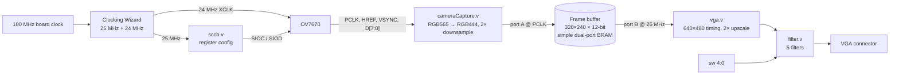

# OV7670 Camera → VGA with Real-Time Filters (Basys 3)

Live video from an OV7670 camera module, buffered in on-chip block RAM and displayed on a 640×480 @ 60 Hz VGA monitor, with five switch-selectable colour filters. Written in Verilog for the Digilent Basys 3 (Xilinx Artix-7 XC7A35T) in Vivado 2025.2.

Final group project for Hardware Synthesis Lab, Computer Engineering.

<!-- TODO: add a photo or short GIF of the board running, e.g. docs/demo.gif -->

## Architecture



The frame buffer is the clock-domain crossing: the camera writes on its own pixel clock (PCLK) and the VGA side reads on the 25 MHz clock, each through its own BRAM port.

| Module | What it does |
|---|---|
| `rtl/top.v` | Top level: clocking, camera, frame buffer, VGA and filter wiring |
| `rtl/sccb.v` | Configures the OV7670 over SCCB (I²C-like) at power-up: reset, clock, PLL, RGB565 output |
| `rtl/cameraCapture.v` | Assembles two bytes per pixel, keeps every second pixel and line (640×480 → 320×240), packs RGB444, writes to BRAM |
| `rtl/vga.v` | 640×480 @ 60 Hz sync generation; reads each buffer pixel twice horizontally and vertically; address = (y << 8) + (y << 6) + x, i.e. y·320 + x without a multiplier |
| `rtl/filter.v` | Registered per-pixel filters selected by the switches |

## Filters

| Switches | Mode |
|---|---|
| all off | Pass-through |
| `sw[0]` | Red isolation |
| `sw[1]` | Green isolation |
| `sw[2]` | Blue isolation |
| `sw[3]` | Grayscale: `gray = (5R + 9G + 2B) >> 4` (≈ 0.31R + 0.56G + 0.13B, shifts and adds only) |
| `sw[4]` | Threshold: white if `gray > 8`, else black |
| more than one on | Black screen |

## Repository layout

```
rtl/           Verilog source
constraints/   Basys 3 pin constraints (Pmod JB/JC for the camera, on-board VGA, switches)
ip/            Clocking Wizard and Block Memory Generator configurations (.xci)
sim/           cocotb testbenches, one folder per module
scripts/       Tcl script that recreates the Vivado project
```

## Build

Requires Vivado (written with 2025.2).

```sh
vivado -mode batch -source scripts/create_project.tcl               # create project in build/
vivado -mode batch -source scripts/create_project.tcl -tclargs build  # ...and run to bitstream
```

Or open Vivado, then *Tools → Run Tcl Script* and pick `scripts/create_project.tcl`.

## Simulation

Unit tests use [cocotb](https://www.cocotb.org/) with Icarus Verilog.

```sh
pip install cocotb          # tested with cocotb 2.1
cd sim/filter && make       # likewise sim/vga, sim/sccb, sim/camera
make WAVES=1                # also dump a waveform (sim_build/*.fst) for GTKWave
```

| Test | Checks |
|---|---|
| `sim/filter` | Every switch mode, including the colour-isolation decision and grayscale value |
| `sim/vga` | Frame-buffer address matches y·320 + x across the first 2,000 pixels |
| `sim/sccb` | All 8 camera registers are sent |
| `sim/camera` | Pixels are written to the buffer during a line |

## Known limitations

- The image is shifted horizontally and wraps around. Narrow strip from the right edge of the video shows up at the left edge of the screen
- The testbenches are smoke tests, not full coverage (e.g. no full-frame VGA timing check, no SCCB bit-level check).

## Team

<!-- TODO: fill in names and confirm everyone is happy with the repo being public -->
- [@1999-Chin](https://github.com/1999-Chin): architecture, frame buffer, VGA output, filters
- [@pedigree-pp](https://github.com/pedigree-pp): camera capture, testbenches
- [@praisepany](https://github.com/praisepany): SCCB camera configuration
